<div align="center">
  <picture>
    <source media="(prefers-color-scheme: dark)" srcset="./dark.svg">
    <source media="(prefers-color-scheme: light)" srcset="./light.svg">
    
  </picture>

  <br>

  <a href="https://komarev.com/ghpvc/?username=yash-sharmaji">
    
  </a>
  <a href="https://github.com/yash-sharmaji?tab=followers">
    
  </a>
</div>

---

## 👋 About Me

I'm a Computer Science undergraduate interested in building useful web applications and solving algorithmic problems.

- 💻 Exploring full-stack development, from responsive interfaces to backend systems.
- 🧠 Practising data structures, algorithms, and competitive programming.
- 🌱 Currently expanding my skills across the MERN ecosystem and modern web tooling.
- 🤝 Interested in open source, collaborative projects, and continuous learning.

```js
const yash = {
  name: "Yash Sharma",
  focus: ["Full-Stack Development", "Competitive Programming"],
  currentlyExploring: ["MERN Stack", "Next.js", "TypeScript", "Tailwind CSS"],
  motto: "Code. Learn. Build. Repeat."
};
```

## 🌐 Connect

<p align="center">
  <a href="https://www.instagram.com/sharma_ji_yash/"></a>
  <a href="https://www.linkedin.com/in/yash-sharmaji/"></a>
  <a href="mailto:yashsharmaji8502@gmail.com"></a>
  <a href="https://github.com/yash-sharmaji"></a>
</p>

## 🧰 Technology Stack

### Programming Languages
<p>
  
</p>

### Frontend Development
<p>
  
</p>

### Backend Development
<p>
  
</p>

### MERN Stack
<p>
  
</p>

### Databases & Services
<p>
  
</p>

### Tools & Platforms
<p>
  
</p>

> Some technologies above are part of my current learning and project exploration, not claims of equal proficiency.

## 📌 Selected Repositories

<p align="center">
  <a href="https://github.com/yash-sharmaji/javascript-youtube">
    
  </a>
  <a href="https://github.com/yash-sharmaji/Frontend-Practice">
    
  </a>
</p>

## 📈 GitHub Analytics

<div align="center">
  
  
  <br>
  
</div>

## 🐍 Contribution Activity

<div align="center">
  
  <br><br>
  <picture>
    <source media="(prefers-color-scheme: dark)" srcset="https://raw.githubusercontent.com/yash-sharmaji/yash-sharmaji/output/github-contribution-grid-snake-dark.svg">
    <source media="(prefers-color-scheme: light)" srcset="https://raw.githubusercontent.com/yash-sharmaji/yash-sharmaji/output/github-contribution-grid-snake.svg">
    
  </picture>
</div>

## 🏆 Achievements

<div align="center">
  
</div>

---

<div align="center">
  <h3>Thanks for stopping by! ✨</h3>
  <p><i>Code. Learn. Build. Repeat.</i></p>
</div>
